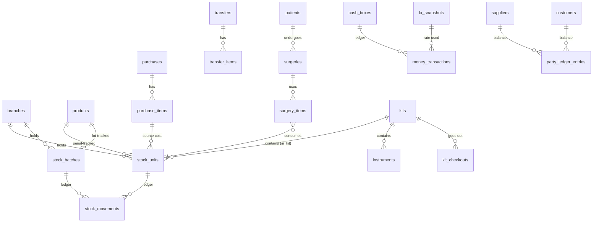

# OrthoTrack — Database Schema (all phases)

> Status: **Approved 2026-10-25.** Phase 0 tables are migrated (`database/migrations/*_p0_*`). PostgreSQL 16+. This file designs every table for Phases 0–5 up front, so later phases only *add* migrations (no redesign).
> The **Ph** column says which phase creates the table.

---

## Conventions

| Convention | Rule |
|---|---|
| Primary keys | `id bigint generated always as identity`. Rows created offline also carry `client_uuid uuid UNIQUE` (idempotent sync). |
| Timestamps | `created_at`, `updated_at` as `timestamptz` (stored UTC, displayed in `Asia/Baghdad`). |
| Who | `created_by`, `updated_by` → `users.id` on every business table (written by a model trait). |
| Money | `numeric(18,4)` — never float. PHP side uses `brick/math` `BigDecimal`. |
| Rates | `numeric(18,8)` (more precision than money; e.g. EUR/USD 1.08345000). |
| Quantity | `integer`, `CHECK (quantity >= 0)` on stock tables. |
| Currency | `char(3)` → FK `currencies.code` (`USD`, `EUR`, `IQD`). |
| FX | Every financial row: `currency` + `fx_snapshot_id` (+ `applied_rate` when a deal rate was used). |
| Translatable | `jsonb` column named in the table as **`tr`**, e.g. `{"en":"Knee","ar":"ركبة","ckb":"ئەژنۆ"}`. Only `en` is required (`CHECK (name ? 'en')`). |
| Status / type | `varchar(32)` + `CHECK (status IN (...))`, mirrored by a PHP backed enum. |
| Void pattern ("**void cols**") | `voided_at timestamptz`, `voided_by`, `void_reason text NOT NULL when voided` — financial/stock records are never hard-deleted. |
| Approval cols ("**appr cols**") | `approved_by`, `approved_at`, `rejected_by`, `rejected_at`, `rejection_reason`. |
| Document numbers | `number varchar(32) UNIQUE`, generated by `DocumentNumberGenerator` from `document_sequences` (e.g. `TRF-DHK-2026-00042`). Always Western digits. |
| Codes | serial / lot / SKU / GTIN / barcode stored exactly as scanned (case-sensitive, no digit conversion). Trigram indexes (`pg_trgm`) for partial search. |
| FKs | Every FK is indexed. `ON DELETE RESTRICT` by default (history must survive); `CASCADE` only for pure child rows of a draft. |
| Append-only | Trigger `forbid_update_delete()` on `stock_movements`, `asset_movements`, `money_transactions`, `party_ledger_entries`, `activity_log`, `exchange_rates`, `fx_snapshots`. |
| Extensions | `pg_trgm`. Case-insensitive usernames/emails use `UNIQUE (lower(col))` indexes + lowercase on save. |
| Cross-phase FKs | The column shapes are fixed here, but a column that points to a table from a *later* phase (e.g. `stock_units.kit_id`, `customer_returns.patient_id`) is added by that later phase's migration. Master data is created early because movements need it: **`suppliers` in Phase 1** and **`customers` in Phase 2**. Their finance columns exist from the start and stay unused until Phase 4. |

---

## Entity overview

---

## Phase 0 — Foundation

### users
| Column | Type | Notes |
|---|---|---|
| id | bigint PK | |
| name | varchar(150) | |
| username | varchar(64), UNIQUE lower() | login with username **or** email |
| email | varchar NULL, UNIQUE lower() | |
| phone | varchar(32) NULL | Western digits |
| password | varchar | bcrypt/argon2id; strong-password rule |
| locale | varchar(8) default `en` | must be a key of `config/locales.php` |
| all_branches | boolean default false | default branch scope = all |
| primary_branch_id | FK branches NULL | default branch in the Ops app |
| is_active | boolean default true | |
| session_timeout_minutes | smallint NULL | per-user override for shared devices |
| app_authentication_secret | text NULL (encrypted) | Filament MFA (TOTP) |
| app_authentication_recovery_codes | text NULL (encrypted) | |
| password_changed_at, last_login_at | timestamptz NULL | |
| last_login_ip | inet NULL | |
| deactivated_at, deactivated_by | | |
| remember_token, timestamps | | |

### branches *(Phase 0 base columns; close workflow in Phase 1)*
| Column | Type | Notes |
|---|---|---|
| id | PK | |
| code | varchar(8) UNIQUE | `DHK`, `EBL`, `BGW` — used in document numbers |
| name | jsonb **tr** | |
| city | jsonb **tr** | |
| address | text NULL | |
| phone | varchar(32) NULL | |
| manager_id | FK users NULL | |
| default_currency | char(3) FK | |
| is_head_office | boolean default false | |
| status | `active` \| `closed` | partial index `WHERE status='active'` for dropdowns |
| closed_at, closed_by, close_reason, reopened_at, reopened_by | | Ph 1 |
| timestamps | | |

### branch_user
`branch_id` FK, `user_id` FK — PK(branch_id, user_id). Default "where" for a user's permissions.

### spatie permission tables
`permissions`, `roles`, `model_has_permissions`, `model_has_roles`, `role_has_permissions` (standard, teams **off** — see ARCHITECTURE D5).

### user_permission_branches *(the "where" override)*
| Column | Type | Notes |
|---|---|---|
| id | PK | |
| user_id | FK users | |
| permission_id | FK permissions | |
| branch_id | FK branches **NULL** | NULL = all branches |
| UNIQUE (user_id, permission_id, branch_id) NULLS NOT DISTINCT | | |

If rows exist for (user, permission) they define the scope; otherwise `branch_user` / `all_branches` applies.

### user_sessions *(device list + "log out this device")*
| id | user_id FK | session_id_hash varchar(64) UNIQUE | device_label varchar(120) | user_agent text | ip inet | panel (`admin`/`ops`) | last_activity_at | revoked_at, revoked_by | created_at |
`TrackUserSession` middleware updates `last_activity_at` (throttled to once a minute) and kills the session if `revoked_at` is set. Sessions themselves stay in Redis.

### login_attempts
| id | username_tried varchar | user_id FK NULL | ip inet | user_agent | successful bool | failure_reason (`bad_password`, `inactive`, `mfa_failed`, `throttled`) | created_at |
Index (ip, created_at), (user_id, created_at).

### activity_log *(spatie + extra columns, append-only)*
Standard spatie columns (`log_name`, `description`, `subject_type/id`, `causer_type/id`, `event`, `properties` jsonb with `old`/`attributes`, `batch_uuid`) **plus**:
`branch_id` bigint NULL (indexed, no FK — the log must outlive a deleted mistaken branch) · `ip_address` inet · `user_agent` text · `reference_code` varchar(64) NULL (serial / lot / document number — indexed, trigram) so the log can be searched by serial.
No `activitylog:clean` scheduled; the append-only trigger blocks edits even by Super Admin.

### settings
| id | group varchar(64) | key varchar(64) | value jsonb | updated_by | timestamps | UNIQUE(group,key) |
Groups: `company`, `locale` (digit system per language), `security`, `approvals` (thresholds), `kits` (overdue days), `fx` (sources), `notifications`, `features` (commissions, credit_sales, price_lists flags).

### notifications *(Laravel standard)* · push_subscriptions *(webpush package)*

### notification_preferences
| id | user_id FK | event_key varchar(64) | channel (`database`,`webpush`,`mail`,`whatsapp`) | enabled bool | UNIQUE(user_id,event_key,channel) |

### attachments
| id | attachable_type, attachable_id (morph, indexed) | kind (`invoice`,`receipt`,`photo`,`implant_sticker`,`credit_note`,`other`) | disk | path | original_name | mime | size_bytes | uploaded_by | created_at |

### document_sequences
| id | type varchar(16) (`TRF`,`REQ`,`SRG`,`PUR`,`PAY`,`INV`,…) | branch_id FK NULL | year smallint | next_number int | UNIQUE(type, branch_id, year) NULLS NOT DISTINCT |
Incremented with `SELECT … FOR UPDATE` → gap-free numbers.

### idempotency_keys
| key uuid PK | user_id FK | endpoint varchar | request_hash char(64) | response_status smallint | response_body jsonb | created_at |
Pruned after 30 days. Used by `/api/sync/*`.

### currencies *(seeded)*
| code char(3) PK | name jsonb **tr** | symbol varchar(8) | decimals smallint (USD 2, EUR 2, IQD 0) | is_active | sort |

Laravel `password_reset_tokens`, `jobs`, `job_batches`, `failed_jobs`; Filament `exports` (+ `failed_import_rows` unused).

---

## Phase 1 — Core inventory

> Built 2026-10-26 (`database/migrations/*_p1_*`). Built differences: `stock_batches` keys its bucket on `unit_cost + cost_currency` until Phase 4 adds `purchase_item_id`; `stock_movements` has an extra `details jsonb` (old → new values of corrections); `branch_locations.name` is optional; `data_imports` has `failure_message`.

### branch_locations *(shelves / storage spots)*
| id | branch_id FK | code varchar(32) | name jsonb **tr** | is_active | UNIQUE(branch_id, code) |

### categories
| id | parent_id FK self NULL | code varchar(32) UNIQUE | name jsonb **tr** | is_active | sort |

### brands
| id | name varchar(120) UNIQUE | country varchar(64) NULL | is_active |

### uoms *(units of measure)*
| id | code varchar(16) UNIQUE (`pc`,`box`,`pack`) | name jsonb **tr** |

### products
| Column | Type | Notes |
|---|---|---|
| id | PK | |
| sku | varchar(64) UNIQUE | |
| gtin | varchar(14) NULL UNIQUE | GS1 AI(01) match |
| name | jsonb **tr** | |
| description | jsonb **tr** NULL | |
| category_id, brand_id, uom_id | FK | |
| size | varchar(64) NULL | e.g. "Size 5 / 28mm" |
| tracking_type | `serial` \| `lot` | |
| is_implant | boolean | used by kit templates & surgery reports |
| requires_expiry | boolean default true | |
| purchase_price, purchase_currency | money, char(3) | default |
| selling_price, selling_currency | money, char(3) | default |
| min_stock_default | integer default 0 | |
| photo_path | varchar NULL | |
| is_active | boolean | |
| timestamps | | |
Indexes: trigram on `sku`, GIN on `name`.

### product_barcodes *(extra codes per product — modular matching)*
| id | product_id FK | barcode varchar(128) UNIQUE | symbology (`gtin`,`ean13`,`code128`,`internal`,`supplier`) | supplier_id FK NULL (Ph 4) | created_at |

### branch_product_settings *(min stock per branch)*
| id | branch_id FK | product_id FK | min_stock int | max_stock int NULL | reorder_qty int NULL | UNIQUE(branch_id, product_id) |

### stock_units *(serial-tracked, one row per physical unit)*
| Column | Type | Notes |
|---|---|---|
| id | PK | |
| product_id | FK | |
| serial | varchar(64) **UNIQUE** (global) | |
| lot | varchar(64) NULL | index + trigram (recall) |
| expiry_date | date NULL | index |
| production_date | date NULL | GS1 AI(11) |
| branch_id | FK | current owner branch |
| status | `in_stock`,`in_transit`,`in_kit`,`out_at_hospital`,`used_in_surgery`,`sold`,`returned_to_supplier`,`damaged`,`lost`,`expired_written_off` | |
| location_type | `shelf`,`kit`,`hospital`,`transit`,`none` | |
| branch_location_id | FK NULL | shelf |
| kit_id | FK kits NULL | "inside kit X" (Ph 3) |
| customer_id | FK customers NULL | out at which hospital (Ph 3) |
| base_unit_cost | money | purchase price per unit |
| landed_unit_cost | money default 0 | allocated landed costs |
| unit_cost | money | = base + landed (true cost) |
| cost_currency | char(3) | |
| cost_fx_snapshot_id | FK fx_snapshots NULL | (Ph 4; nullable before) |
| purchase_item_id | FK NULL | source purchase (Ph 4) |
| supplier_id | FK NULL | denormalized for recall/reports |
| received_at | timestamptz | |
| last_expiry_level_id | FK expiry_levels NULL | for "entered a new level" notifications |
| lock_version | integer default 0 | optimistic check for UI double-submit |
| timestamps | | |
Indexes: (product_id, branch_id, status), (branch_id, status, expiry_date) for FEFO, (kit_id), (status), (lot).

### stock_batches *(lot-tracked buckets)*
| Column | Type | Notes |
|---|---|---|
| id | PK | |
| product_id | FK | |
| lot | varchar(64) NULL | |
| expiry_date, production_date | date NULL | |
| branch_id | FK | |
| location_type | `shelf`,`kit`,`hospital` | |
| branch_location_id | FK NULL | |
| kit_id | FK NULL | consumables loaded into kit trays |
| customer_id | FK NULL | out at hospital inside a kit |
| quantity | integer CHECK ≥ 0 | on hand in this bucket |
| base_unit_cost, landed_unit_cost, unit_cost, cost_currency, cost_fx_snapshot_id | | as stock_units |
| purchase_item_id, supplier_id | FK NULL | cost layer source |
| last_expiry_level_id | FK NULL | |
| timestamps | | |
UNIQUE (product_id, branch_id, lot, expiry_date, purchase_item_id, location_type, branch_location_id, kit_id, customer_id) NULLS NOT DISTINCT — one bucket per cost layer per location. Index (branch_id, product_id, expiry_date) WHERE quantity > 0 → FEFO.

### stock_movements *(THE stock ledger — append-only)*
| Column | Type | Notes |
|---|---|---|
| id | PK | |
| movement_group | uuid | all rows of one operation |
| type | `opening_balance`,`import`,`purchase_receipt`,`transfer_send`,`transfer_receive`,`transfer_cancel`,`kit_load`,`kit_unload`,`kit_checkout`,`kit_return`,`surgery_use`,`surgery_reversal`,`sale`,`sale_return`,`customer_return`,`supplier_return`,`write_off`,`count_adjustment`,`status_override`,`cost_adjustment` | |
| product_id | FK | |
| stock_unit_id | FK NULL | serial movement |
| from_batch_id, to_batch_id | FK NULL | lot movement (from bucket → to bucket) |
| quantity | integer > 0 | 1 for serial |
| from_branch_id, to_branch_id | FK NULL | |
| from_status, to_status | varchar(32) NULL | |
| from_location_type, to_location_type | varchar(16) NULL | |
| from_kit_id, to_kit_id | FK NULL | |
| customer_id | FK NULL | hospital involved |
| unit_cost, cost_currency, fx_snapshot_id | | cost at time of movement (COGS) |
| reference_type, reference_id | morph | transfer, surgery, sale, write-off, … |
| reason | text NULL | |
| is_override | boolean default false | expired override etc. |
| override_reason | text NULL | required when is_override |
| user_id | FK | |
| occurred_at | timestamptz | |
| created_at | timestamptz | |
Indexes: (stock_unit_id, occurred_at), (from_batch_id), (to_batch_id), (product_id, occurred_at), (reference_type, reference_id), (from_branch_id), (to_branch_id), (movement_group).

### expiry_levels
| id | name jsonb **tr** | min_days int NULL | max_days int NULL | color char(7) | text_color char(7) (auto) | sort smallint | is_expired_level bool (exactly one; undeletable; rule fixed ≤ 0) | blocks_usage bool | notify_on_enter bool | timestamps |
Seed: Expired (≤0) `#111827` · Critical 1–90 `#DC2626` · Warning 91–180 `#EA580C` · Attention 181–365 `#EAB308` · Good 366+ `#16A34A`.
`ExpiryLevelService` validates contiguity (no gap, no overlap, last level open-ended). Reports join with `(expiry_date - current_date) BETWEEN coalesce(min_days, -2147483648) AND coalesce(max_days, 2147483647)`.

### label_templates
| id | name | width_mm, height_mm numeric(6,2) | symbology (`code128`,`datamatrix`,`gs1_datamatrix`,`qr`) | layout jsonb (fields, font sizes) | is_default bool |

### unrecognized_scans *(helps add new barcode formats when real boxes arrive)*
| id | raw text | raw_hex text | context (`surgery`,`transfer`,`receive`,`count`,`lookup`) | branch_id | user_id | created_at |

### data_imports
| id | type (`products`,`stock`,`min_stock`) | user_id | branch_id NULL | original_disk, original_path, original_filename | status (`uploaded`,`validating`,`previewed`,`confirmed`,`processing`,`completed`,`failed`,`cancelled`) | total_rows, new_count, updated_count, unchanged_count, error_count, warning_count, processed_rows | error_file_path NULL | started_at, finished_at | timestamps |

### data_import_rows
| id | data_import_id FK (CASCADE) | row_number int | action (`create`,`update`,`unchanged`,`error`) | raw jsonb | normalized jsonb | diff jsonb (`{field:{old,new}}`) | errors jsonb | warnings jsonb (e.g. expired) | target_type, target_id NULL | applied_at NULL |
Index (data_import_id, action).

### Views
* `v_stock_on_hand` — product_id, branch_id, qty_shelf, qty_in_kits, qty_at_hospital, qty_in_transit, qty_available (= shelf), stock_value_usd.
* `v_low_stock` — joins `v_stock_on_hand` with `branch_product_settings` / `products.min_stock_default`.

---

## Phase 2 — Movement

> **As built (2026-10-26):** `issues` also has `title` (readable one-line summary, in the language of the user who caused it). `write_offs` keeps cost per item (`write_off_items.unit_cost` + `cost_currency`); `total_cost_usd` stays empty and the `fx_snapshot_id` / `credit_note_id` columns are added by Phase 4 with exchange rates and credit notes. `transfer_assets` is created in Phase 3 with kits and instruments (P2-8). `v_stock_on_hand.qty_in_transit` now also counts lot quantities on transfers in transit (for the sending branch).

### transfers
| id | number | from_branch_id, to_branch_id FK | status (`draft`,`in_transit`,`received`,`received_with_discrepancy`,`cancelled`) | stock_request_id FK NULL | carrier_note text NULL | notes | created_by | sent_by, sent_at | received_by, received_at | cancelled_by, cancelled_at, cancel_reason | timestamps |
CHECK from_branch_id <> to_branch_id. Index (to_branch_id, status), (from_branch_id, status).

### transfer_items
| id | transfer_id FK | product_id | stock_unit_id FK NULL | from_batch_id FK NULL | to_batch_id FK NULL | quantity_sent int | quantity_received int NULL | line_status (`pending`,`received`,`short`,`missing`,`extra`) | resolution (`none`,`found`,`written_off`,`returned_to_sender`) | override_reason NULL | timestamps |
`extra` = scanned at the receiver but not on the slip (quantity_sent 0).

### transfer_assets *(kits & instruments travel the same flow)*
| id | transfer_id FK | kit_id FK NULL | instrument_id FK NULL | status (`pending`,`received`,`missing`) | CHECK exactly one of kit/instrument |

### stock_requests
| id | number | requesting_branch_id FK | preferred_source_branch_id FK NULL (NULL = head office / any) | status (`pending`,`approved`,`partially_approved`,`rejected`,`fulfilled`,`cancelled`) | priority (`normal`,`urgent`) | needed_by date NULL | notes | requested_by | reviewed_by, reviewed_at, review_note | timestamps |

### stock_request_items
| id | stock_request_id FK | product_id | quantity_requested int | quantity_approved int NULL | source_branch_id FK NULL (chosen per line; FEFO suggestion) | transfer_id FK NULL | note |

### customer_returns *(hospital / patient / customer → our stock)*
| id | number | branch_id | customer_id FK NULL | patient_id FK NULL | status (`draft`,`completed`,`cancelled`) | received_by, received_at | notes | void cols | timestamps |

### customer_return_items
| id | customer_return_id FK | product_id | stock_unit_id NULL | stock_batch_id NULL | quantity | origin_type, origin_id (surgery_item / sales_invoice_item / kit_checkout_item) | reason (`unused`,`wrong_size`,`cancelled_surgery`,`other`) | condition (`good`,`damaged`) | outcome (`restocked`,`to_write_off`) | write_off_id FK NULL | credit_note_id FK NULL (Ph 4) |

### supplier_returns
| id | number | supplier_id FK | branch_id | status (`draft`,`sent`,`credited`,`cancelled`) | credit_note_id FK NULL | currency, fx_snapshot_id | total_credit money | sent_by, sent_at | notes | void cols | timestamps |

### supplier_return_items
| id | supplier_return_id FK | product_id | stock_unit_id NULL | stock_batch_id NULL | quantity | reason (`expired`,`defective`,`recall`,`wrong_item`,`other`) | purchase_item_id FK NULL | unit_credit money |

### write_offs
| id | number | branch_id | reason (`damaged`,`lost`,`expired`,`other`) | status (`pending`,`approved`,`rejected`,`cancelled`) | note text | source_type, source_id NULL (customer_return / stock_count / kit_checkout) | reported_by, reported_at | appr cols | total_cost_usd money | timestamps |
Photos → `attachments`.

### write_off_items
| id | write_off_id FK | product_id | stock_unit_id NULL | stock_batch_id NULL | quantity | target_status (`damaged`,`lost`,`expired_written_off`) | unit_cost, cost_currency, fx_snapshot_id |

### stock_counts
| id | number | branch_id | scope (`full`,`category`,`location`) | category_id NULL | branch_location_id NULL | status (`in_progress`,`submitted`,`reviewed`,`closed`,`cancelled`) | snapshot_at | started_by, started_at | submitted_by, submitted_at | reviewed_by, reviewed_at | notes | timestamps |

### stock_count_lines *(expected vs found)*
| id | stock_count_id FK | product_id | stock_unit_id NULL | stock_batch_id NULL | expected_qty int | counted_qty int | result (`found`,`missing`,`extra_other_branch`,`extra_unknown`,`qty_mismatch`) | found_branch_id NULL | resolution (`pending`,`adjusted`,`written_off`,`investigating`,`ignored`) | resolved_by, resolved_at | note |

### stock_count_scans *(raw scans, synced from the device)*
| id | stock_count_id FK | client_uuid UNIQUE | raw_code text | parsed jsonb | resolved_type, resolved_id NULL | quantity int default 1 | scanned_by | scanned_at | device_label |

### issues *(one queue for things the Super Admin must resolve)*
| id | type (`unaccounted_implant`,`transfer_discrepancy`,`count_discrepancy`,`cash_difference`,`expired_override`,`unknown_scan`) | severity (`info`,`warning`,`critical`) | branch_id | subject_type, subject_id | details jsonb | status (`open`,`resolved`,`dismissed`) | resolved_by, resolved_at, resolution_note | timestamps |
Index (status, type, branch_id). Feeds dashboard alerts.

---

## Phase 3 — Clinical & assets

> **As built (2026-10-26):** `stock_units` / `stock_batches` got `kit_id` + `customer_id`; the lot bucket key now includes `kit_id` (a kit's lots are their own bucket; a kit at a hospital keeps its bucket with `location_type = hospital`). `stock_movements` got `from_kit_id`, `to_kit_id`, `customer_id` (foreign keys on PostgreSQL; plain columns on the SQLite preview, which would otherwise rebuild the append-only table). `surgeries` also has `problems` (jsonb: why a synced draft is still a draft); `surgery_items.used_at` marks lines taken out of stock — the "one live surgery per serial" unique index covers used, non-reversed lines (drafts may share a serial until one completes). `kit_checkout_items` also has `resolved_by` / `resolved_at`. `instruments` keep a purchase cost (asset value) — payables arrive with Phase 4. Price lists (open question 6) are not created yet. The stock views live in `App\Support\Database\StockViews` so migrations that rebuild stock tables recreate them.

### customers *(hospitals and other customers — created in Phase 2, documented here)*
| id | code varchar(32) UNIQUE | type (`hospital`,`clinic`,`distributor`,`individual`) | name jsonb **tr** | city jsonb **tr** NULL | address, phone, email, contact_person | tax_number NULL | default_currency | credit_enabled bool default false | credit_limit money NULL | price_list_id FK NULL | notes | is_active | timestamps |
Customer receivables are ready for Phase 4 via `party_ledger_entries`. `credit_enabled` stays false until the open question is answered.

### price_lists / price_list_items *(open question 6 — feature-flagged)*
`price_lists`: id, name jsonb **tr**, currency, valid_from, valid_to, is_active.
`price_list_items`: id, price_list_id FK, product_id FK, price money, UNIQUE(price_list_id, product_id).

### patients *(sensitive)*
| id | file_number varchar(32) UNIQUE | full_name varchar(150) | phone text NULL (**encrypted**) | phone_hash char(64) NULL (lookup) | date_of_birth date NULL | birth_year smallint NULL (when only age known) | gender (`male`,`female`) NULL | notes text NULL (**encrypted**) | branch_id (registered at) | primary_doctor_id FK users NULL | created_by | timestamps |
Trigram index on full_name. Every view of a patient record is written to the activity log.

### surgery_types
| id | code varchar(32) UNIQUE | name jsonb **tr** | default_kit_type_id FK NULL | is_active | sort |

### surgeries
| Column | Type | Notes |
|---|---|---|
| id, number | | |
| client_uuid | uuid UNIQUE | offline draft sync |
| branch_id | FK | |
| customer_id | FK (hospital) | |
| patient_id | FK | |
| surgery_type_id | FK | |
| laterality | `left`,`right`,`bilateral`,`na` | knee/hip |
| surgery_date | date | |
| kit_id, kit_checkout_id | FK NULL | |
| status | `draft`,`completed`,`cancelled` | |
| notes | text | |
| completed_by, completed_at | | |
| cancelled_by, cancelled_at, cancel_reason | | cancelling reverses stock (`surgery_reversal`) |
| **billing hook:** fee_amount money NULL, fee_currency, fee_fx_snapshot_id, sales_invoice_id FK NULL, billing_status (`not_billed`,`billed`,`waived`) | | open question 4 |
| timestamps | | |
Index (branch_id, surgery_date), (patient_id), (customer_id).

### surgery_doctors
| surgery_id FK | user_id FK | role (`lead`,`assistant`) | PK(surgery_id, user_id) |

### surgery_items
| id | surgery_id FK | product_id | stock_unit_id FK NULL UNIQUE WHERE reversed_at IS NULL (a serial can be in only one live surgery) | stock_batch_id FK NULL | quantity | source (`shelf`,`kit`) | kit_id NULL | unit_cost, cost_currency, fx_snapshot_id | warnings jsonb (`not_in_branch`,`not_in_kit`) | override_reason NULL | scanned_raw text NULL | reversed_at, reversed_by, reversal_reason | timestamps |

### kit_types
| id | code UNIQUE | name jsonb **tr** | description jsonb **tr** NULL | is_active |

### instrument_types
| id | code UNIQUE | name jsonb **tr** | is_active |

### kit_template_items *(expected contents per kit type)*
| id | kit_type_id FK | item_kind (`instrument`,`product`) | instrument_type_id FK NULL | product_id FK NULL (an implant size = a product) | expected_qty int | is_required bool | sort | CHECK exactly one of instrument_type/product |

### kits
| id | code varchar(32) UNIQUE | barcode varchar(128) UNIQUE | kit_type_id FK | home_branch_id FK | branch_id FK (current) | status (`available`,`in_transit`,`out_at_hospital`,`in_maintenance`,`missing`,`retired`) | customer_id FK NULL | current_checkout_id FK NULL | photo_path | notes | last_prepared_at | timestamps |
Contents are derived (`stock_units.kit_id`, `stock_batches.kit_id`, `instruments.kit_id`), so there's no duplicate state.

### instruments
| id | code UNIQUE | barcode UNIQUE | instrument_type_id FK | manufacturer_serial varchar NULL | branch_id FK | kit_id FK NULL | status (`available`,`in_kit`,`in_transit`,`out_at_hospital`,`in_maintenance`,`missing`,`damaged`,`retired`) | holder_user_id FK NULL | customer_id FK NULL | purchase_cost money NULL, purchase_currency NULL, purchased_at NULL, supplier_id NULL | notes | timestamps |

### asset_movements *(ledger for kits & instruments — append-only)*
| id | movement_group uuid | asset_type, asset_id (kit/instrument) | type (`create`,`prepare`,`checkout`,`return`,`transfer_send`,`transfer_receive`,`maintenance_in`,`maintenance_out`,`mark_missing`,`found`,`assign_holder`,`add_to_kit`,`remove_from_kit`,`retire`) | from_branch_id, to_branch_id | from_status, to_status | from_kit_id, to_kit_id | customer_id NULL | holder_user_id NULL | reference_type, reference_id | note | user_id | occurred_at |

### kit_checkouts
| id | number | kit_id FK | branch_id | customer_id (hospital) | doctor_id FK users | patient_id FK NULL | planned_surgery_date | due_back_at | status (`out`,`returned`,`reconciled`,`reconciled_with_issues`) | checked_out_by, checked_out_at | returned_by, returned_at | reconciled_by, reconciled_at | notes | timestamps |
Index (status, due_back_at) → overdue kits.

### kit_checkout_items *(snapshot of what left + reconciliation result)*
| id | kit_checkout_id FK | item_kind (`instrument`,`unit`,`batch`) | instrument_id NULL | stock_unit_id NULL | stock_batch_id NULL | product_id NULL | qty_out int | qty_returned int default 0 | qty_used int default 0 | qty_unaccounted int default 0 | outcome (`pending`,`returned`,`used_in_surgery`,`unaccounted`,`damaged`,`missing`) | surgery_item_id FK NULL | issue_id FK NULL | note |

---

## Phase 4 — Money

> Built 2026-10-26 (`database/migrations/2026_10_29_*`). Built differences: no `shipments` table (landed costs belong to a purchase); `cash_boxes.allow_overdraft` (bank accounts only); `approvals.type` is `supplier_payment`, `expense`, `commission_payout`; supplier payment status is `pending_approval`, `posted`, `rejected`, `voided`; `landed_costs.cogs_amount` keeps the part on items already used or sold; `stock_units` / `stock_batches` carry `purchase_item_id` + `cost_fx_snapshot_id` (the lot bucket key includes `purchase_item_id`); `stock_movements`, `write_offs`, `supplier_returns` (+ `credit_note_id`), `customer_return_items.credit_note_id`, `surgeries.fee_fx_snapshot_id` / `sales_invoice_id` added. `money_transactions` and `party_ledger_entries` are append-only (trigger).

### exchange_rates *(append-only history)*
| id | base_currency | quote_currency | rate numeric(18,8) | source (`manual`,`ecb`,`api_other`) | status (`suggested`,`confirmed`,`rejected`) | effective_at | set_by FK NULL | confirmed_by, confirmed_at | note | created_at |
Pairs: `USD→IQD` (manual; API value is only a suggestion), `EUR→USD` (auto-fetched suggestion, confirm or auto-confirm per setting).

### fx_snapshots *(immutable rate set used by financial rows)*
| id | usd_iqd numeric(18,8) | eur_usd numeric(18,8) | usd_iqd_rate_id FK | eur_usd_rate_id FK | created_at |
A new snapshot is created whenever a rate is confirmed; "current" = latest. Converting any amount to any currency uses only its own snapshot.

### cash_boxes
| id | branch_id FK NULL (NULL = head office) | name jsonb **tr** | type (`cash`,`bank`) | currency | bank_name, account_number, iban NULL | current_balance money (cached, updated under lock) | is_active | opened_at, closed_at | timestamps |
UNIQUE(branch_id, currency) WHERE type='cash' AND is_active.

### money_transactions *(THE money ledger — append-only)*
| Column | Type | Notes |
|---|---|---|
| id | PK | |
| movement_group | uuid | e.g. both legs of an exchange |
| cash_box_id | FK | |
| branch_id | FK NULL | |
| type | `opening_balance`,`sale_receipt`,`customer_payment`,`supplier_payment`,`expense`,`exchange_out`,`exchange_in`,`box_transfer_out`,`box_transfer_in`,`refund`,`closing_adjustment`,`commission_payout`,`reversal` | |
| amount | money **signed** (+ in / − out) | in box currency |
| currency | char(3) | = box currency |
| fx_snapshot_id | FK | |
| applied_rate | numeric(18,8) NULL | deal rate if any |
| amount_usd | money | denormalized via snapshot (fast reports) |
| balance_after | money | running balance of the box |
| reference_type, reference_id | morph | |
| reverses_id | FK self NULL | voids = new reversing row |
| description | text | |
| user_id | FK | |
| occurred_at | timestamptz | |
Index (cash_box_id, occurred_at), (reference_type, reference_id), (type, occurred_at).

### cash_box_closings
| id | cash_box_id FK | business_date date | opening_balance, expected_balance, counted_balance, difference money | difference_reason text (required if difference ≠ 0) | denominations jsonb NULL | last_money_transaction_id FK | status (`draft`,`submitted`,`reviewed`) | counted_by | submitted_at | reviewed_by, reviewed_at, review_note | UNIQUE(cash_box_id, business_date) |
Locked (read-only) after `submitted`.

### box_transfers *(cash between boxes / branches, same currency)*
| id | number | from_cash_box_id, to_cash_box_id | amount | currency | fx_snapshot_id | status (`sent`,`received`,`cancelled`) | sent_by, sent_at | received_by, received_at | void cols |

### currency_exchanges
| id | number | branch_id | from_cash_box_id, to_cash_box_id | from_amount, from_currency | to_amount, to_currency | rate numeric(18,8) (deal) | fx_snapshot_id (reference/market) | gain_loss_usd money (deal vs reference) | performed_by, performed_at | note | void cols |

### suppliers *(created in Phase 1 — documented here with the payables it serves)*
| id | code UNIQUE | name varchar(150) | country varchar(64) | contact_person, phone, email, address | default_currency | payment_terms_days smallint NULL | notes | is_active | timestamps |
Attachments via `attachments`.

### shipments *(optional in-transit grouping)*
| id | number | reference varchar (AWB / B/L) | carrier | status (`ordered`,`shipped`,`in_customs`,`arrived`,`received`,`cancelled`) | eta date | shipped_at, arrived_at | notes | timestamps |

### purchases *(supplier invoices)*
| id | number | supplier_id FK | supplier_invoice_number varchar | branch_id (receiving) | shipment_id FK NULL | invoice_date, due_date | currency, fx_snapshot_id | subtotal, discount, total money | paid_amount money (cached) | status (`draft`,`confirmed`,`cancelled`) | receiving_status (`not_received`,`in_transit`,`partially_received`,`received`) | payment_status (`unpaid`,`partial`,`paid`) | notes | confirmed_by, confirmed_at | void cols | timestamps |
UNIQUE(supplier_id, supplier_invoice_number). Index (due_date) WHERE payment_status <> 'paid'.

### purchase_items
| id | purchase_id FK | product_id | quantity int | quantity_received int default 0 | unit_price money | line_total money | expected_lot, expected_expiry NULL | landed_cost_per_unit money default 0 | true_unit_cost money |

### purchase_receipts / purchase_receipt_items *(partial receiving by scan or Excel)*
`purchase_receipts`: id, number, purchase_id, branch_id, method (`scan`,`manual`,`excel`), received_by, received_at, notes.
`purchase_receipt_items`: id, purchase_receipt_id, purchase_item_id, stock_unit_id NULL, stock_batch_id NULL, serial NULL, lot NULL, expiry_date NULL, quantity.

### landed_costs / landed_cost_allocations
`landed_costs`: id, number, shipment_id NULL, purchase_id NULL (one required), type (`shipping`,`customs`,`clearance`,`bank_fee`,`other`), payee_supplier_id NULL (freight forwarder → creates payable), amount, currency, fx_snapshot_id, allocation_method (`value`,`quantity`), status (`draft`,`allocated`,`voided`), allocated_at, void cols.
`landed_cost_allocations`: id, landed_cost_id, purchase_item_id, amount (in item's purchase currency), per_unit_amount, rate_used. Applied via `cost_adjustment` stock movements. Units already used or sold get the adjustment booked to COGS.

### supplier_payments
| id | number | supplier_id | cash_box_id | amount, currency (box currency), fx_snapshot_id | method (`bank_wire`,`hawala`,`cash`,`cheque`,`other`) | reference varchar | paid_at | status (`pending_approval`,`approved`,`rejected`,`posted`,`voided`) | requested_by | appr cols | money_transaction_id FK NULL | notes | void cols | timestamps |

### supplier_payment_allocations
| id | supplier_payment_id | purchase_id | amount_in_purchase_currency | rate_used numeric(18,8) | fx_gain_loss_usd money (realized: invoice snapshot vs payment rate) |

### party_ledger_entries *(supplier & customer balances, per currency — append-only)*
| id | party_type, party_id (supplier/customer) | entry_type (`opening`,`invoice`,`payment`,`credit_note`,`return`,`landed_cost`,`adjustment`,`reversal`) | currency | amount money signed (+ increases balance owed) | fx_snapshot_id | reference_type, reference_id | description | user_id | occurred_at |
Statement = ordered entries; balance = SUM grouped by currency.

### credit_notes *(both directions)*
| id | number | party_type, party_id | direction (`from_supplier`,`to_customer`) | source_type, source_id (supplier_return / customer_return) | currency, fx_snapshot_id | amount | status (`open`,`applied`,`voided`) | applied_to_type, applied_to_id NULL | timestamps |

### approvals *(single queue → dashboard approve/reject)*
| id | approvable_type, approvable_id | type (`supplier_payment`,`expense`,`write_off`,`stock_request`,`expired_override`) | branch_id | amount money NULL, currency NULL, amount_usd NULL | status (`pending`,`approved`,`rejected`,`cancelled`) | requested_by, requested_at | decided_by, decided_at, decision_note | Index (status, type) |

### sales_invoices
| id | number | branch_id | customer_id FK NULL (walk-in) | walk_in_name NULL | patient_id NULL | surgery_id NULL (billing hook) | currency, fx_snapshot_id | price_list_id NULL | subtotal, discount, total money | paid_amount money | payment_terms (`cash`,`credit`) | due_date NULL | status (`draft`,`issued`,`partially_paid`,`paid`,`voided`) | issued_by, issued_at | void cols | timestamps |

### sales_invoice_items
| id | sales_invoice_id | product_id | stock_unit_id NULL | stock_batch_id NULL | quantity | unit_price, discount, line_total money | unit_cost, cost_currency, cost_fx_snapshot_id (profit) | returned_qty int default 0 | override_reason NULL |

### customer_payments / customer_payment_allocations
`customer_payments`: id, number, customer_id NULL, cash_box_id, amount, currency, fx_snapshot_id, applied_rate NULL, method, reference, received_by, received_at, status (`posted`,`voided`), money_transaction_id, void cols.
`customer_payment_allocations`: id, customer_payment_id, sales_invoice_id, amount_in_invoice_currency, rate_used, fx_gain_loss_usd.

### expense_categories
| id | parent_id NULL | code UNIQUE | name jsonb **tr** | is_active | sort |
Seed: rent, salaries, transport, utilities, shipping, customs, hospitality, other.

### expenses
| id | number | branch_id NULL (head office) | expense_category_id | amount, currency, fx_snapshot_id | cash_box_id | expense_date | payee | description | recurring_expense_id NULL | status (`pending_approval`,`posted`,`rejected`,`voided`) | requested_by | appr cols | money_transaction_id NULL | is_allocated bool | void cols | timestamps |

### expense_allocations
| id | expense_id | branch_id | percentage numeric(7,4) | amount money | CHECK SUM = 100 (enforced in service) |

### recurring_expenses
| id | branch_id NULL | expense_category_id | cash_box_id NULL | amount, currency | description | frequency (`monthly`) | day_of_month smallint | starts_on, ends_on NULL | last_generated_for date NULL | auto_post bool (else creates pending) | is_active |

### commission_rules / commission_entries *(open question 5 — feature-flagged)*
`commission_rules`: id, doctor_id NULL (all), basis (`per_surgery`,`per_product`), surgery_type_id NULL, product_id NULL, category_id NULL, calc_type (`fixed`,`percent`), value numeric(18,4), currency NULL, valid_from, valid_to, is_active.
`commission_entries`: id, doctor_id, surgery_id, surgery_item_id NULL, commission_rule_id, amount, currency, fx_snapshot_id, status (`accrued`,`approved`,`paid`,`voided`), money_transaction_id NULL.

---

## Phase 5 — Insight & ops

> Built 2026-10-27 (`database/migrations/2026_10_30_*`). Instead of PostgreSQL views (they would not run on the SQLite preview), reports are PHP query classes in `app/Services/Reports` that convert each row with its own `fx_snapshot_id`; the nightly history is a table:
>
> * **stock_value_snapshots** — id, snapshot_date date, branch_id FK, currency, value money, value_usd money NULL, units int, fx_snapshot_id FK NULL, created_at; UNIQUE(snapshot_date, branch_id, currency). Written by `reports:snapshot` (23:50); re-running a day replaces it.
> * **scheduler_heartbeats** — name PK (job name), last_started_at, last_finished_at, last_status (`ok`,`failed`), last_output, updated_at. Read by the System health page.
> * Indexes: expenses (expense_date, expense_category_id), surgeries (surgery_date, status).
> * No `spatie/laravel-health` tables (D8 not taken — the health page reads its checks live).

Planned (kept for reference):
* **Reporting views/materialized views** — `mv_daily_stock_value` (branch × day, refreshed nightly), `v_profit_lines` (sale/surgery item revenue − true cost, joined to snapshots for any display currency), `v_supplier_balances`, `v_overdue_purchases`, `v_kits_overdue`.
* `spatie/laravel-health` result tables *(if D8 approved)*.
* Backups: no tables (spatie/laravel-backup; notifications to Coda admin mail).

---

## Table count

| Phase | Tables (by section above) |
|---|---|
| 0 | 26 (incl. 5 spatie + 6 Laravel/Filament system tables) |
| 1 | 15 + 2 views (+ `suppliers`) |
| 2 | 15 (+ `customers`) |
| 3 | 16 |
| 4 | 30 |
| 5 | views only |
| **Total** | **102** |
